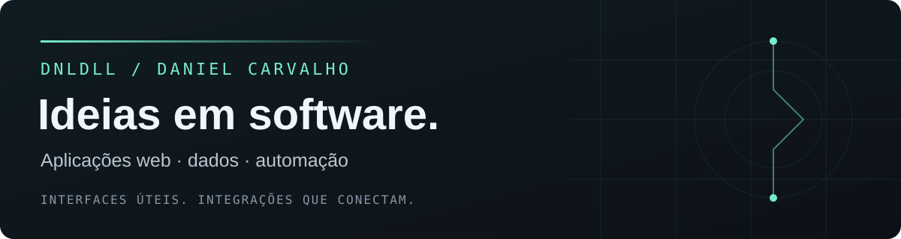

### Software que conecta dados, interfaces e automação.

Sou Daniel Carvalho. Desenvolvo projetos com aplicações web, integrações e visualização de dados, com atenção à clareza da interface e ao uso no dia a dia.

**Meu foco:** transformar uma necessidade concreta em uma ferramenta útil, conectando interface, API e dados.

---

### Tecnologias com que trabalho

`TypeScript` · `JavaScript` · `React` · `Next.js` · `Node.js` 
`Python` · `Flask` · `PostgreSQL` · `APIs REST` · `Automação`

### Projeto aberto

**[Crypto Signal · VelaSignal](https://github.com/dnldll/crypto-signal)**

Painel experimental de indicadores técnicos para BTC e ETH. Combina Python, Flask e pandas com uma interface para explorar gráficos, sinais calculados e diferentes períodos.

[Explorar o código e a documentação](https://github.com/dnldll/crypto-signal)

---

### Como penso meus projetos

- **Interface:** informação legível e ações compreensíveis.
- **Integração:** conectar serviços e reduzir trabalho repetitivo.
- **Dados:** mostrar o contexto por trás de um número.
- **Evolução:** revisar, testar e melhorar continuamente.

[Veja meus repositórios públicos](https://github.com/dnldll?tab=repositories&type=public).
